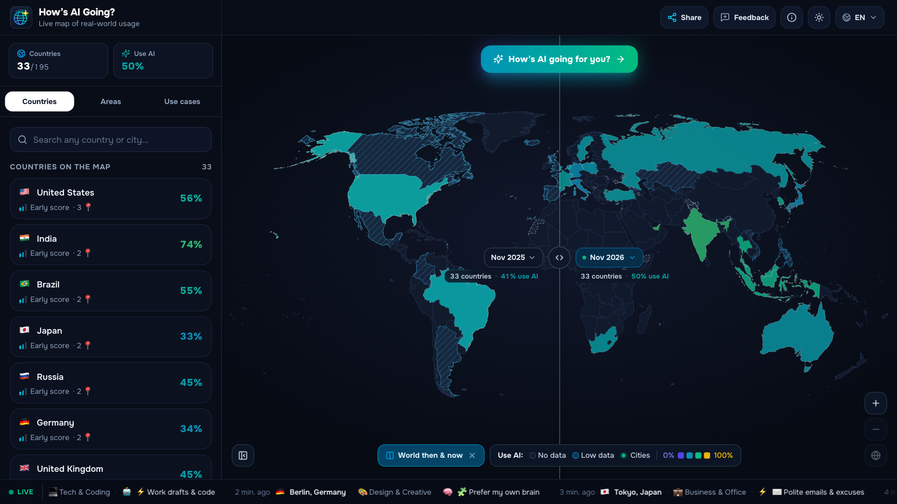

# How’s AI Going?

An anonymous live global map showing how everyday people around the world actually use AI across work, study, and daily life — or why they skip it — with a 12-month **"then & now"** comparison.

**[Live App → https://howsaigoing.org](https://howsaigoing.org)**



## Overview

Public discussions around AI tend to swing between hype and doom, while existing adoption numbers mostly come from corporate whitepapers or tech-bubble polls. **How’s AI Going?** captures the ground-level picture across countries, cities, and everyday professions — explicitly welcoming people who rarely or never touch AI alongside daily users.

## Key Features

- **Interactive Global Map:** Natural Earth 2D map (`d3-geo` + `world-atlas` 50m) with neutral disputed-territory rendering (`Natural Earth` breakaway boundaries) and a perceptually uniform Viridis color scale.
- **World Then & Now:** Interactive split-curtain comparison tracking how adoption shifted over the past 12 months (`12m`, `6m`, `3m`, `now`).
- **5-Second Anonymous Check-in:** Single-step survey with optional domain/use-case filters, zero accounts, zero cookies, and a downloadable `1080×1080` PNG result card.
- **Calibration Thresholds:** Countries and cities stay uncolored ("calibrating") with live city pins until they cross minimum sample thresholds, preventing small-sample noise from distorting rankings.
- **7 Languages & Dual Themes:** Full localization in `EN`, `RU`, `ES`, `PT-BR`, `JA`, `KO`, and `DE`, with Light and Dark modes.

## Architecture & Engineering Highlights

- **Frontend:** React 19, TypeScript, Vite 6, Tailwind CSS v4. Map TopoJSON geometry (`world-atlas` + disputed areas) is dynamically imported on demand, cutting initial JS bundle size by ~59% (`543 kB` / `165 kB` gzip).
- **Edge Backend:** Hono on Cloudflare Workers + Cloudflare D1 (SQLite), serving both static assets and API endpoints at the edge.
- **Edge Caching & Consistency:** `GET /api/snapshot` uses Cloudflare `caches.default` (`15s` live, `60s` historical) with automatic default-snapshot invalidation on `POST /api/signal`.
- **Privacy & Anti-Abuse:** No raw IPs stored — only daily salted SHA-256 hashes for rate-limiting (`5` new / `12` total signals per hour, `6` feedback/hr), salted browser tokens for idempotent updates, same-origin write enforcement, and `0.1°` (~11 km) coordinate rounding.
- **Dynamic Edge SEO:** `HTMLRewriter` injects live D1 country percentages, canonical URLs, and Open Graph tags per `/country/:code` and `/area/:role`, paired with dynamic `/robots.txt`, `/sitemap.xml`, and JSON-LD.

## Documentation

- [docs/CONCEPT.md](./docs/CONCEPT.md) — product design, taxonomy, calibration model, and roadmap.
- [docs/ARCHITECTURE.md](./docs/ARCHITECTURE.md) — Cloudflare Workers + D1 schema, caching, and API design.

<details>
<summary>Local development</summary>

```bash
pnpm install
pnpm db:migrate:local
pnpm db:seed:local
pnpm dev
```

Open `http://localhost:5173`.

</details>

## License

[MIT](./LICENSE)
